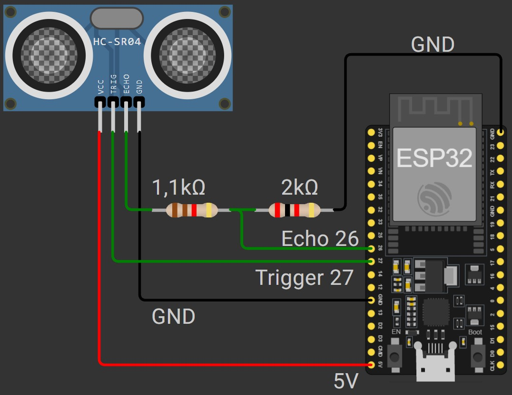
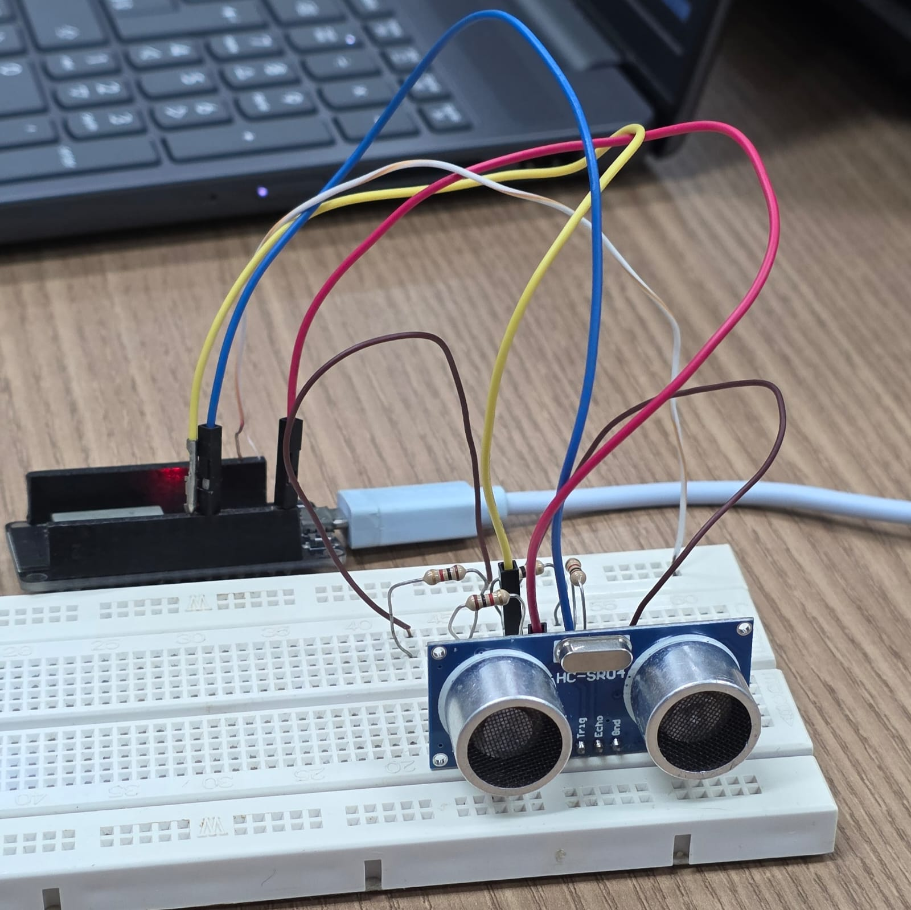
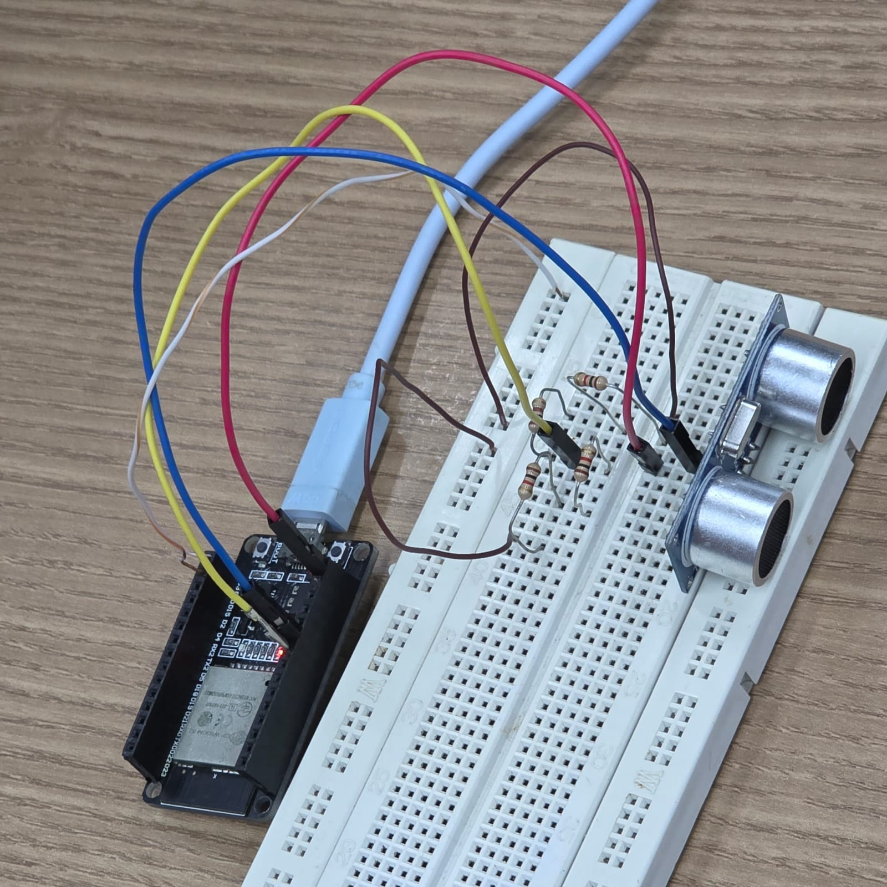
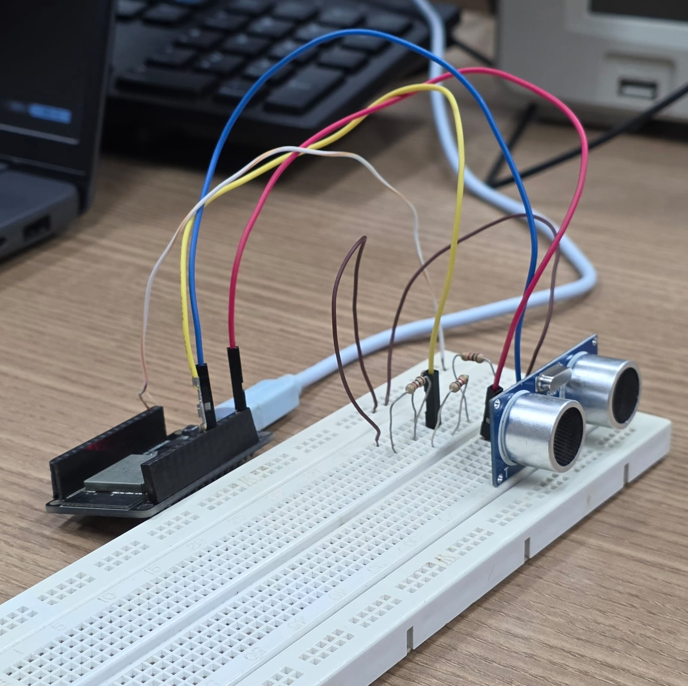
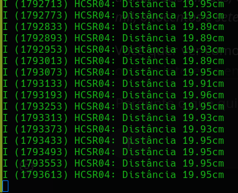
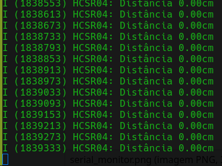
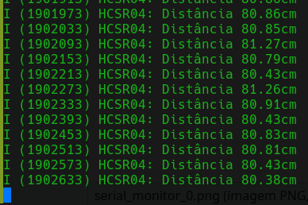

## Plataformas de Hardware para Internet das Coisas
### Docente: Luiz de França Afonso Ferreira Filho 
### Discentes: 
- Davi Vieira de Carvalho lima
- Leandro Antony Batista Lemos
- Mariana Jamile dos Santos Ferreira
- Vinicius Costa Soares

# ESP32: medidor de distância com sensor ultrassônico HC-SR04

Projeto de laboratório para ESP32 que combina **saída digital (pulso de disparo)**, **interrupções (ISR)**, **medição de pulso (`esp_timer_get_time()`)** e **comunicação serial (`ESP_LOGI()`)** em um único circuito. O ESP32 dispara o sensor **HC-SR04**, mede o tempo de retorno do estado `HIGH` do `ECHO` baseado na borda de subida ou descida da porta por detecção assíncrona via interrupção e converte esse tempo em distância, exibindo o resultado no monitor serial. A distância máxima de detecção é configurável: objetos além do limite resultam em leitura `0`.

## Sumário

- [Funcionalidades](#funcionalidades)
- [Materiais](#materiais)
- [Mapeamento de pinos](#mapeamento-de-pinos)
- [Esquema de ligação](#esquema-de-ligação)
- [Diagrama do circuito](#diagrama-do-circuito)
- [Como funciona](#como-funciona)
- [Fotos](#fotos)
- [Como compilar e gravar](#como-compilar-e-gravar)
- [Saída serial](#saída-serial)
- [Problemas enfrentados](#problemas-enfrentados)
- [Parâmetros configuráveis](#parâmetros-configuráveis)
- [Estrutura do repositório](#estrutura-do-repositório)

## Funcionalidades

- Disparo do sensor com pulso de 10 $\mu s$ no pino `TRIG`.
- Medição da duração do eco no pino ECHO com `esp_timer_get_time()`.
- Conversão do tempo em distância (cm) usando a velocidade do som.
- Distância máxima de detecção ajustável por uma única constante (`MAX_DISTANCE`).
- Retorno `0` para objetos fora do alcance configurado.
- Monitoramento das medições pela porta serial (115200 baud).

## Materiais

| Qtd | Componente | Observação |
|-----|------------|------------|
| 1 | Placa ESP32 (DevKit) | |
| 1 | Sensor ultrassônico HC-SR04 | Faixa de 2 cm a 400 cm **(datasheet)** |
| 1 | Resistor 1,1 kΩ | Divisor de tensão no `ECHO` |
| 1 | Resistor 2 kΩ | Divisor de tensão no `ECHO` |
| — | Protoboard e jumpers | Quanto for necessário |

## Mapeamento de pinos

| Função | GPIO | Tipo | Observação |
|--------|------|------|------------|
| `TRIG` | 27 | Saída digital | Pulso de 10 $\mu s$ |
| `ECHO` | 26 | Entrada digital | Via divisor de tensão (5 V → ~3,2 V) |
| `VCC` do sensor | 5V / VIN | Alimentação | O HC-SR04 opera em 5 V |
| `GND` | GND | Terra comum | Sensor, divisor e ESP32 |

## Esquema de ligação

- **VCC:** pino `VCC` do HC-SR04 no 5V / VIN do ESP32.
- **GND:** pino `GND` do HC-SR04 no GND do ESP32.
- **TRIG:** pino `TRIG` do HC-SR04 direto no GPIO 27.
- **ECHO:** o `ECHO` sai em 5 V, mas os GPIOs do ESP32 suportam 3,3 V. Por isso ele passa por um **divisor de tensão**:

```
ECHO ──[ 1,1 kΩ ]──┬──[ 2 kΩ ]── GND
                   │
                 GPIO 26
```

$$V_{out} = 5\text{V} \cdot \frac{2000}{1100 + 2000} \approx 3{,}23\,\text{V}$$

> A ordem importa: o resistor de 2 kΩ fica do lado do GND.

### Diagrama do circuito


(Wokwi)

## Como funciona

1. Na inicialização, o firmware configura a serial (115200 baud), o pino TRIG como saída e o pino `ECHO` como entrada.
2. A cada ciclo do `while(1)` `(60ms)`:
   1. Envia um pulso HIGH de 10 $\mu s$ no TRIG e depois o torna LOW.
   2. Por consequência, o `ECHO` é levado ao nível HIGH. A interrupção detecta qualquer borda referente ao `ECHO`, medindo o tempo($\mu s$) que ele esteve durante HIGH. 
   3. Quando a borda sobe, é gravado o tempo instantâneo em `before`. 
   4. Quando a borda desce, é gravado  o tempo instantâneo em `after`.
   5. Ao fim é armazenado o tempo que echo passou em HIGH na variável `diff = after - before`.
   6. Calcula a distância: usando-se a fórmula $d = \frac{v \cdot \text{diff}}{2} = \frac{0,0343\frac{cm}{\mu s} \cdot \text{diff} \mu s}{2} = 0,01715 \cdot \text{diff}$ cm
   7. Se a distância passar de `MAX_DISTANCE`, o valor é substituído por `0`.
   8. Imprime o resultado na serial (`ESP_LOGI()`).

| Situação | Saída |
|----------|-------|
| Objeto dentro do alcance configurado | Distância medida em cm |
| Objeto além de `MAX_DISTANCE` | `0` |

### Fotos

- Circuito montado





- Medições no monitor serial



- Medições no monitor serial (objeto fora do alcance: leitura 0)



- Medições no monitor serial (distância um pouco maior)



## Como compilar e gravar

### ESP IDF

1. Realize a instalação da plataforma ESP IDF na sua máquina.
2. Rode no terminal:
   1. `idf.py` `set-target` `SUA_PLACA (Ex: esp32)`
   2. `idf.py` `build`
   3. `idf.py` `--port` `PORTA` `flash` `monitor`
## Saída serial

Certifique de que o monitor serial está configurado para **115200 baud**. Cada ciclo imprime uma linha com a distância medida:

```
I (1838613) HCSR04: Distância: 6.42cm
I (1838673) HCSR04: Distância: 15.98cm
I (1838733) HCSR04: Distância: 111.60cm
I (1838793) HCSR04: Distância: 89.74cm
```

## Problemas enfrentados
No projeto realizado, não se possuía um ESP32 com saída de 5V, portanto, foi utilizado a porta VIN para alimentação do HC-SR04.
O funcionamento ocorreu normalmente, apesar dessa adaptação. Lembrando que os testes feitos foram com o ESP32 sendo alimentado pela porta USB.

## Parâmetros configuráveis

| Constante | Valor | Descrição |
|-----------|-------|-----------|
| `TRIG` | GPIO_NUM_27 | Pino de disparo do sensor `TRIG` |
| `ECHO` | GPIO_NUM_26 | Pino de leitura do `ECHO` |
| `MAX_DISTANCE` | 400 | Distância máxima de detecção (cm); além dela a leitura é 0 |

Para mudar o alcance, edite a constante:

```cpp
#define MAX_DISTANCE = 400; // detecta até 400 cm
```

## Estrutura do repositório

```
.
├── CMakeLists.txt
├── images
│   └── [ ... ]
├── main
│   ├── CMakeLists.txt
│   └── main.c
└── README.md
```
